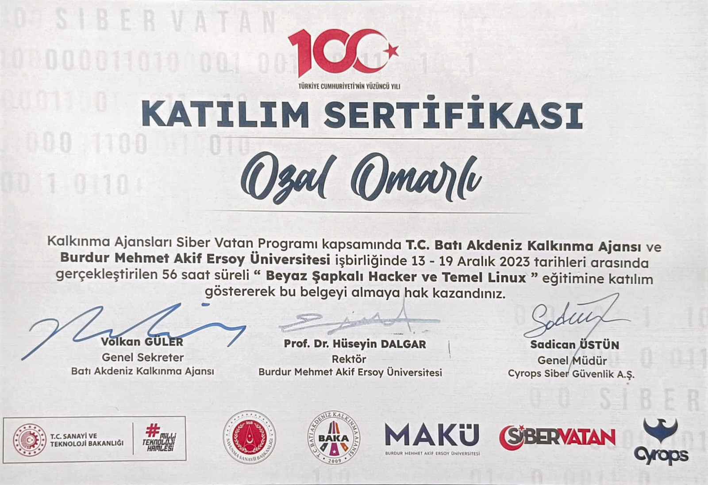
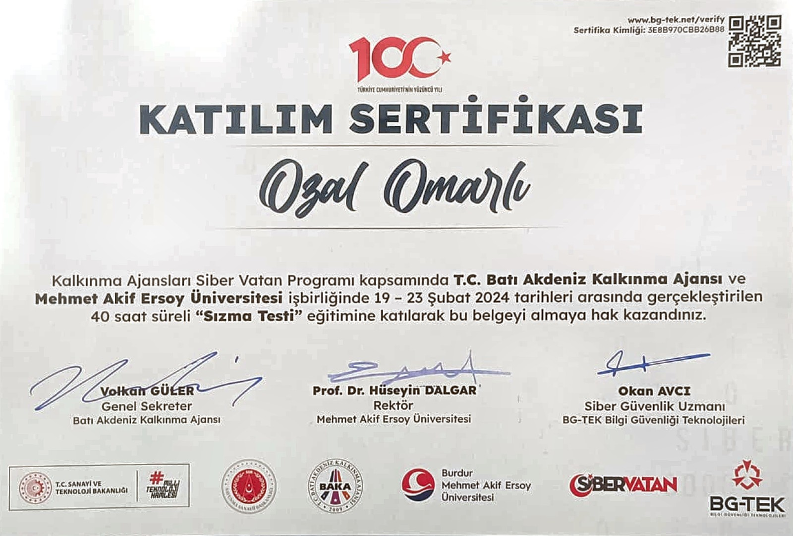

  

  

  
  

---

## 👋 Hakkımda

OSTİM Teknik Üniversitesi Fen Bilimleri Enstitüsü'nde **Yazılım Mühendisliği yüksek lisans** öğrencisiyim; **bilgisayarlı görü**, **derin öğrenme** ve **siber güvenlik** alanlarında çalışıyorum. Görüntü işleme tarafında nesne tespiti modellerinin gerçek koşullardaki (bulanıklık, eğiklik, uzak/yakın nesne, aydınlatma) dayanıklılığıyla ve bu dayanıklılığın **dürüst ölçülmesiyle** ilgileniyorum: deneylerimi önceden yazılmış protokollerle, eşit bütçe ve çoklu tohumla yürütüyor, kilitli test kümeleri kullanıyor ve tüm sonuçları raporluyorum. Güvenlik tarafında keşif, ağ trafiği analizi, web uygulama güvenliği ve sosyal mühendislik farkındalığı üzerine yetkili laboratuvar ortamlarında çalışıyorum.

- 🎓 **Eğitim:** Yazılım Mühendisliği Yüksek Lisans, OSTİM Teknik Üniversitesi Fen Bilimleri Enstitüsü
- 🏅 **Siber güvenlik eğitimleri:** Siber Vatan — *Beyaz Şapkalı Hacker ve Temel Linux* (56 saat) ve *Sızma Testi* (40 saat)
- 🧪 **Yöntem ilkem:** ön-kayıt · eşit bütçe · çoklu tohum · kilitli/harici test · her testi raporla
- 🛡️ **Güvenlik ilkem:** yalnız yetkili ve izole ortamlarda, etik çerçevede test
- 💬 **Konuşmaktan keyif aldığım konular:** nesne tespiti, veri artırımı, model değerlendirme, sızma testi, YZ etiği

---

## 📄 Yayınlar

> **Güvenli Dijitalleşme ve Yapay Zekâ Etiği Bağlamında Proaktif Risk Algılama: YOLOv8 Tabanlı Erken Uyarı Sistemi** 
> *Dijital Dünyanın Kullanıcıları Üniversitelerarası Öğrenci Sempozyumu*, Erzincan Binali Yıldırım Üniversitesi · Bildiri Kitabı, s. 277–290 
> 📄 [Sempozyum bildiri kitabı (PDF)](https://ogrencisempozyumu.ebyu.edu.tr/Sempozyum_Bildiri_Kitabi.pdf#page=280)

---

## 📌 Öne Çıkan Proje

<table>
  <tr>
    <td width="100%">
      <h3>🔥 <a href="https://ogrencisempozyumu.ebyu.edu.tr/Sempozyum_Bildiri_Kitabi.pdf#page=280">YOLOv8 Tabanlı Proaktif Erken Yangın Uyarı Sistemi</a></h3>
      
Dumanı yangının <b>erken habercisi (prekürsör)</b> olarak ele alan, gerçek zamanlı kamera görüntülerinde <b>duman</b> ve <b>alev</b> tespit eden bir erken uyarı sistemi. <b>İki düzeyli alarm politikası</b> (ön uyarı + kritik alarm) yanlış alarm yükünü ve kaçırılan tespit riskini birlikte yönetir; <b>etik kalibrasyon, insan denetimi ve açıklanabilirlik</b> tasarımın parçasıdır.

      <table>
        <tr><th>Genel mAP50</th><th>Yangın (P / R)</th><th>Duman (P / R)</th></tr>
        <tr><td align="center"><b>0.86</b></td><td align="center">0.91 / 0.88</td><td align="center">0.79 / 0.83</td></tr>
      </table>
      <ul>
        <li><b>Veri:</b> Kaggle Fire-Smoke Dataset, Kaggle CVA_YOLO_S&amp;F ve Roboflow Fire Smoke Detection birleştirildi; depo, laboratuvar, ofis, tünel ve endüstriyel iç mekân sahneleri, gündüz/gece koşulları</li>
        <li><b>Eğitim:</b> COCO ön-eğitimli ağırlıklarla transfer öğrenme, AdamW, 50+ epoch; mozaik, rastgele ölçekleme, yatay çevirme, HSV ve kırpma/kaydırma artırımları</li>
        <li><b>Alarm:</b> düşük/orta güvenli duman → operatöre ön uyarı ve doğrulama; zamansal sürekliliği olan yüksek güvenli duman ve/veya alev → kritik alarm</li>
      </ul>
      

        
        
        
        
      

    </td>
  </tr>
</table>

---

## 🏅 Siber Güvenlik Sertifikaları

<table>
  <tr>
    <td width="50%" valign="top">
      
      <h4>🎩 Beyaz Şapkalı Hacker ve Temel Linux</h4>
      
<b>56 saat</b> · 13–19 Aralık 2023 
      Kalkınma Ajansları <b>Siber Vatan Programı</b> (T.C. Sanayi ve Teknoloji Bakanlığı) 
      T.C. Batı Akdeniz Kalkınma Ajansı ve Burdur Mehmet Akif Ersoy Üniversitesi işbirliği 
      Eğitim: Cyrops Siber Güvenlik A.Ş.

    </td>
    <td width="50%" valign="top">
      
      <h4>🎯 Sızma Testi</h4>
      
<b>40 saat</b> · 19–23 Şubat 2024 
      Kalkınma Ajansları <b>Siber Vatan Programı</b> (T.C. Sanayi ve Teknoloji Bakanlığı) 
      T.C. Batı Akdeniz Kalkınma Ajansı ve Burdur Mehmet Akif Ersoy Üniversitesi işbirliği 
      Eğitim: BG-TEK Bilgi Güvenliği Teknolojileri 
      Doğrulama: <a href="https://www.bg-tek.net/verify">bg-tek.net/verify</a> · Kimlik <code>3E8B970CBB26B88</code>

    </td>
  </tr>
</table>

---

## 🛡️ Siber Güvenlik

| Alan | Araçlar |
|:--|:--|
| **Keşif ve tarama** |   |
| **OSINT** |  |
| **Ağ trafiği analizi** |  |
| **Web uygulama güvenliği** |  |
| **Kimlik doğrulama testleri** |  |
| **Sosyal mühendislik ve oltalama farkındalığı** |   |
| **Active Directory analizi** |  |
| **Platform ve betik** |    |

---

## 👁️ Görüntü İşleme ve Derin Öğrenme

| Alan | Araçlar |
|:--|:--|
| **Görüntü işleme** |  |
| **Nesne tespiti** |   |
| **Sınıflandırma omurgaları** |  |
| **Derin öğrenme çatıları** |    |
| **Bilimsel Python** |     |
| **GPU ve araştırma altyapısı** |    |
| **Veri kümeleri** |       |

---

  <i>“Önce ölç, sonra iddia et.”</i> 
  Tüm güvenlik çalışmaları yalnız yetkili ve izole ortamlarda, etik kurallar çerçevesinde yürütülür.

